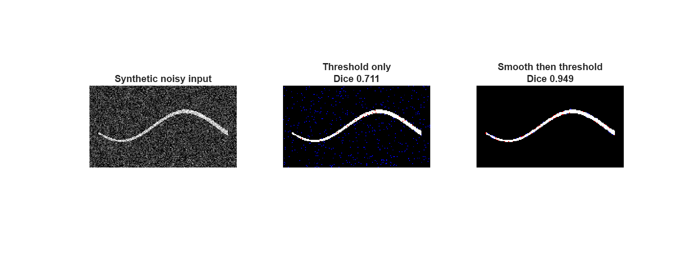
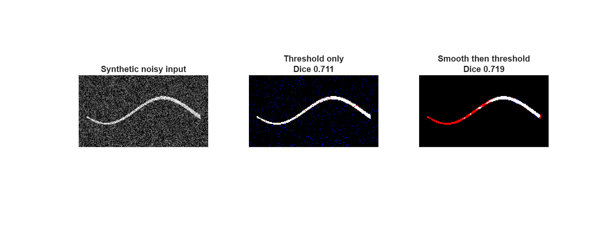

# Thin-structure segmentation in MATLAB

A small synthetic-image experiment exploring how smoothing affects noise reduction and preservation of fine structures.

## Experiment

I ran a MATLAB script that generates a curved band of varying width, adds Gaussian noise, and compares intensity thresholding with thresholding after mean filtering.

Both runs use the same random seed and threshold. Only the smoothing window changes between 3×3 and 7×7 pixels.

## Results

| Method | Dice overlap |
|---|---:|
| Threshold only | 0.711 |
| 3×3 mean filter followed by thresholding | 0.949 |
| 7×7 mean filter followed by thresholding | 0.719 |

Dice measures overlap between the predicted segmentation and the known reference mask. A value of 1 indicates perfect overlap.

### 3×3 smoothing window

### 7×7 smoothing window

White pixels indicate correct overlap, red pixels indicate missed structure, and blue pixels indicate incorrectly included background.

The 3×3 filter removed most isolated background detections while preserving the narrow part of the band. The 7×7 filter averaged the thin structure with surrounding background, causing much of that section to fall below the threshold.

## Reproduce the experiment

1. Open `thin_band_demo.m` in MATLAB.
2. Set `windowSize = 3` and run the script.
3. Set `windowSize = 7` and run it again.

Each run prints the Dice score and pixel-error counts and saves a PNG figure in the current folder.

## Scope

This educational example uses one synthetic image and one fixed noise realization. The results illustrate the effect of smoothing-window size under these conditions. Evaluation on medical images would require appropriate datasets and additional validation.

## Contribution

I ran the experiments in MATLAB Online, changed the smoothing-window size, and compared the numerical and visual results.
